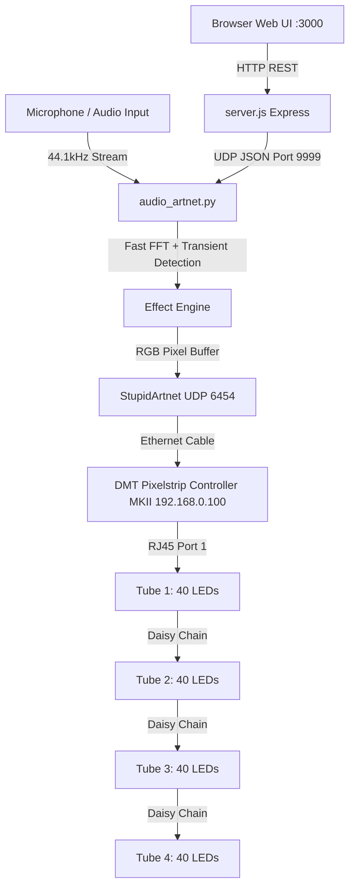

# ART-NET SILLINESS: AUDIO-REACTIVE PIXEL CONTROLLER
> **Architectural Documentation and Hardware Guide for AI Agents**  
> *Last Updated: September 2026*

This document provides complete technical documentation for the **Art-Net Silliness** project. Any future AI agents working on this codebase must consult this guide to understand the physical hardware setup, network requirements, audio pipeline, and software architecture.

---

## 1. System Overview & Architecture

The system enables real-time, ultra-low-latency sound-reactive illumination of professional DMX LED pixel tubes using Art-Net (DMX512 transmitted over UDP Ethernet).



### Key Components:
1. **Python Sound & Art-Net Engine ([`artnet/audio_artnet.py`](file:///c:/Users/Dillo/OneDrive/Desktop/Github/Website/public/MiniProjects/artNetSilliness/artnet/audio_artnet.py))**:
   - Listens to system microphone via `sounddevice` at 44.1 kHz.
   - Performs windowed FFT (4096 samples, Hanning window) across 32 Mel-spaced log bands.
   - Computes instant transient onset detection (512-sample window) for percussive hits (stick clacks, table taps, drums).
   - Generates animations at 45 FPS and streams raw DMX channel buffers to the controller over Art-Net.
2. **Node.js Express Backend ([`artnet/server.js`](file:///c:/Users/Dillo/OneDrive/Desktop/Github/Website/public/MiniProjects/artNetSilliness/artnet/server.js))**:
   - Serves the local Control Center UI on `http://localhost:3000`.
   - Bridges UI changes (slider movements, animation selections) to Python in real-time via UDP socket on `127.0.0.1:9999`.
3. **Web Control Center ([`artnet/public/index.html`](file:///c:/Users/Dillo/OneDrive/Desktop/Github/Website/public/MiniProjects/artNetSilliness/artnet/public/index.html))**:
   - Glassmorphic dark-mode dashboard with interactive animation selector cards, sliders (Pixel Count, Gain Multiplier, Temporal Smoothing, Noise Gate), and live Web Audio FFT oscilloscope.
4. **1:1 Light Tube Digital Twin Simulator ([`simulator.html`](file:///c:/Users/Dillo/OneDrive/Desktop/Github/Website/public/MiniProjects/artNetSilliness/simulator.html) & [`artnet/public/simulator.html`](file:///c:/Users/Dillo/OneDrive/Desktop/Github/Website/public/MiniProjects/artNetSilliness/artnet/public/simulator.html))**:
   - Full 1:1 hardware simulation of the 4 DMT Pixelstrip MKII tubes (40 LEDs each = 160 total pixels) with frosted diffuser shaders, aluminum chassis, volumetric glow, and live DMX inspector.
   - Accepts live Art-Net UDP 6454 packets directly from Python/Resolume via SSE `/api/artnet-stream`, or runs standalone with unfiltered Web Audio transient detection.
   - Includes topology simulation (Single Daisy Chain, Split Port 1+2, and broken Tube 3 output jack failure simulation).
   - Features a live custom pixel shader sandbox (Pixelblaze-style JavaScript runner).
5. **Browser Canvas Simulator ([`index.html`](file:///c:/Users/Dillo/OneDrive/Desktop/Github/Website/public/MiniProjects/artNetSilliness/index.html) & [`scripts.js`](file:///c:/Users/Dillo/OneDrive/Desktop/Github/Website/public/MiniProjects/artNetSilliness/scripts.js))**:
   - Standalone client-side HTML5 canvas preview embedded directly in the comic web portfolio page.

---

## 2. Hardware Specifications & Topology

### Controller
* **Model**: **Showtec / DMT Pixelstrip Controller MKII** (Product Code: `42273`).
* **Factory Default IP**: `192.168.0.100` (Subnet: `255.255.255.0`).
* **Protocol**: Art-Net II / III on UDP Port `6454`.
* **Output Ports**: 4 RJ45 output ports on the rear panel.
  * `Port 1` $\rightarrow$ Universe 0
  * `Port 2` $\rightarrow$ Universe 1
  * `Port 3` $\rightarrow$ Universe 2
  * `Port 4` $\rightarrow$ Universe 3
* **Display Menu**:
  * `[40 LED] PIXELSTRIP` — Fixture model configuration.
  * `Length [4M]` — Capacity configuration (1M to 4M per output port).

### Light Tubes
* **Model**: **DMT PixelStrip P25 MKII** (Product Code: `42270` / `42271`).
* **LEDs**: 40 RGB LEDs per 1-meter tube = 120 DMX channels.
* **Daisy-Chain Capacity**: Each controller output supports **up to 4 tubes in series** (4 meters = 160 pixels / 480 channels). 480 channels fit completely inside a single 512-channel DMX universe.

### Physical Wiring & IN / OUT Directionality
* Each tube spine features **TWO RJ45 ports**:
  * **DATA IN**: Connected from the controller or the previous tube's OUT port.
  * **DATA OUT**: Connected to the next tube downstream in the chain.
* **CRITICAL HARDWARE FAILURE MODE**:
  * Each tube acts as an **active digital repeater** (like WS2811 / UCS1903 shift-registers).
  * If a tube has a defective or damaged `DATA OUT` jack or output driver, **that tube will still light up its own 40 LEDs**, but **zero data will pass downstream**.
  * The symptom is that all downstream tubes will be stuck in **White Standby Mode** (receiving 24V power, but no digital data signal).
  * **Solution**: Replace the failing tube, or move the defective tube to the very end of the chain as fixture #4 so it doesn't need to pass signal to any further fixture.

---

## 3. Network Configuration

1. **Host Ethernet Adapter**:
   - Static IP: `192.168.0.101`
   - Subnet Mask: `255.255.255.0`
   - Configured automatically in `audio_artnet.py` via `netsh` upon startup.
2. **Network Restoration**:
   - When finished, run [`artnet/restore_network.bat`](file:///c:/Users/Dillo/OneDrive/Desktop/Github/Website/public/MiniProjects/artNetSilliness/artnet/restore_network.bat) to revert the Ethernet adapter to DHCP (automatic IP).
3. **Port Diagnostics**:
   - Run [`artnet/test_ports.py`](file:///c:/Users/Dillo/OneDrive/Desktop/Github/Website/public/MiniProjects/artNetSilliness/artnet/test_ports.py) to send solid primary colors to individual universes:
     * Port 1 (Universe 0) = RED
     * Port 2 (Universe 1) = GREEN
     * Port 3 (Universe 2) = BLUE
     * Port 4 (Universe 3) = MAGENTA

---

## 4. Audio Processing & Transient Detection

### Why Percussive Hits (Stick Taps, Table Strikes) Require Special Handling
1. **Time-Domain Dilution**:
   - A stick hitting a table or a drum transient lasts only **2 to 5 milliseconds**.
   - Standard FFT buffers are 4096 samples ($\approx 93\text{ ms}$).
   - Averaging energy over $93\text{ ms}$ dilutes a short impact by over $90\%$, causing noise gates to discard it while passing sustained human speech.
2. **Instantaneous Peak & Onset Detection in `analyze_frame()`**:
   - The engine checks the latest 512 samples ($\approx 11.6\text{ ms}$) for `inst_peak = max(abs(recent))`.
   - If `inst_peak` exceeds the background baseline by $>0.08$, `state.impact` is triggered with an instant attack ($1.0$) and fast exponential decay ($\times 0.80$).
   - `effective_vol = max(rms, inst_peak * 0.45)` ensures percussive hits elevate overall volume immediately without lag.
3. **Laptop Microphone DSP**:
   - Modern laptops enable AI noise suppression and echo cancellation in hardware/drivers, which actively filters out keyboard clicks and table taps.
   - Web Audio `getUserMedia` calls must specify:
     ```javascript
     { audio: { echoCancellation: false, noiseSuppression: false, autoGainControl: false } }
     ```

---

## 5. Animation Registry (Pixelblaze & Moon Modules Inspired)

All animations are registered in the `EFFECTS` dictionary in [`artnet/audio_artnet.py`](file:///c:/Users/Dillo/OneDrive/Desktop/Github/Website/public/MiniProjects/artNetSilliness/artnet/audio_artnet.py):

| Animation Key | Name | Visual Description | Audio Reactivity |
|---|---|---|---|
| `spectrum` | Frequency Spectrum | 32 log-spaced frequency bands with falling peak markers | FFT band energy across full spectrum |
| `bass` | Bass Pulse | Low-frequency radial bloom expanding from center out | Sub-bass ($40-120\text{ Hz}$) + transient impacts |
| `vu` | VU Meter | Center-out volume level fill with peak marker retention | RMS volume ($0-100\%$) |
| `wave` | Color Wave | Traveling sine waves with chromatic shift | Mid frequencies and volume |
| `rainbow` | Rainbow Scroll | Dynamic cycling spectrum | Bass-accelerated rotation |
| `fire` | Fire Simulation | Upward heat convection with dynamic cooling and base sparks | Screams, volume, bass, and impact fireballs |
| `sparkle` | High Sparkle | Twinkling star field over warm shifting ambient glow | Volume, treble, and percussive hit starbursts |
| `plasma` | Aurora Plasma | Multi-octave wave superposition (Pixelblaze equation) | Warped by bass; impacts ignite electric white arcs |
| `matrix` | Cyber Rain | Flowing digital code drops with phosphor trails | Beats & impacts spawn bursts of rushing white-head drops |
| `pulse` | Supernova Ripple | Concentric shockwaves expanding outward (Moon Modules) | Percussive hits launch expanding rings that collide |
| `chaser` | Beat Comet | High-speed light comets with logarithmic decay tails | Transient hits launch comets rocketing along the strip |

---

## 6. How to Add a New Animation

To add a new animation pattern:
1. In [`artnet/audio_artnet.py`](file:///c:/Users/Dillo/OneDrive/Desktop/Github/Website/public/MiniProjects/artNetSilliness/artnet/audio_artnet.py):
   - Define `def effect_myname(state):` returning an `(N, 3)` uint8 NumPy array.
   - Register `"myname": effect_myname` in `EFFECTS`.
2. In [`artnet/public/index.html`](file:///c:/Users/Dillo/OneDrive/Desktop/Github/Website/public/MiniProjects/artNetSilliness/artnet/public/index.html):
   - Add a `<div class="anim-card" data-anim="myname">` card to the animation grid.
3. In [`scripts.js`](file:///c:/Users/Dillo/OneDrive/Desktop/Github/Website/public/MiniProjects/artNetSilliness/scripts.js) & [`index.html`](file:///c:/Users/Dillo/OneDrive/Desktop/Github/Website/public/MiniProjects/artNetSilliness/index.html):
   - Add a button `<button class="mode-btn" data-mode="myname">` to the preview UI.
   - Add a `case 'myname':` rendering block inside `renderVisualizer()`.
