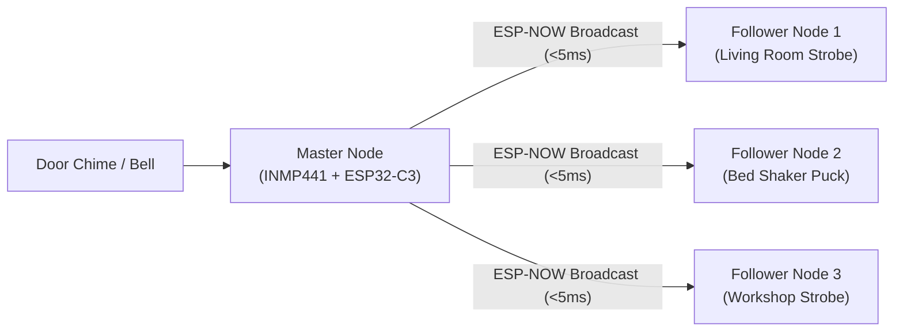
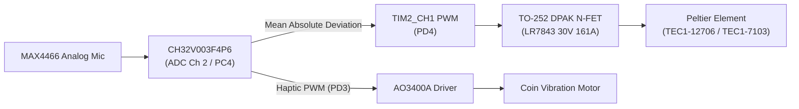
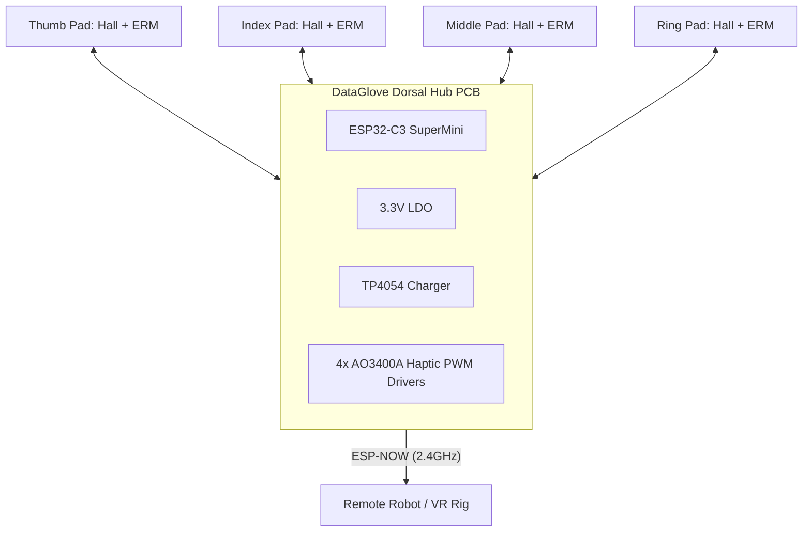
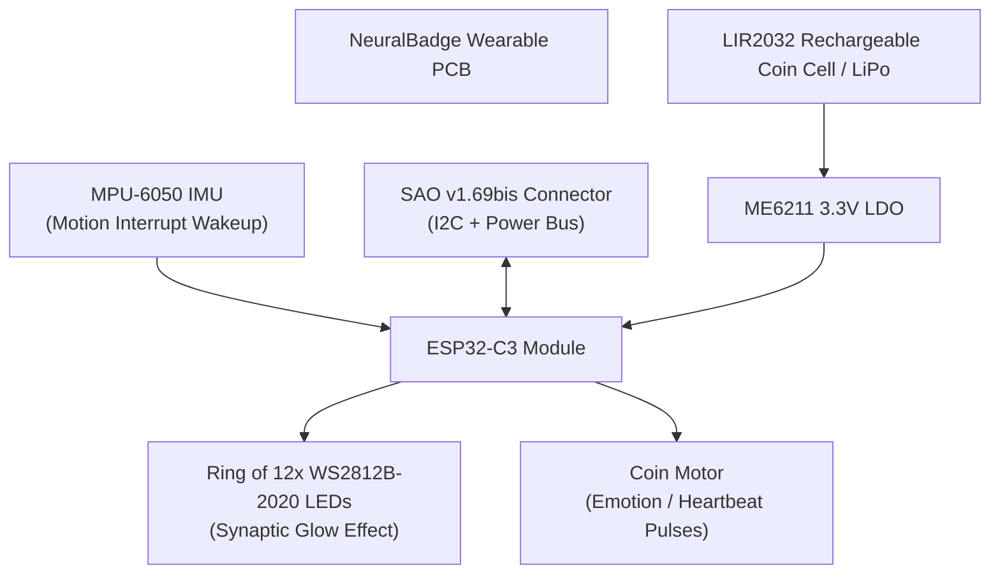
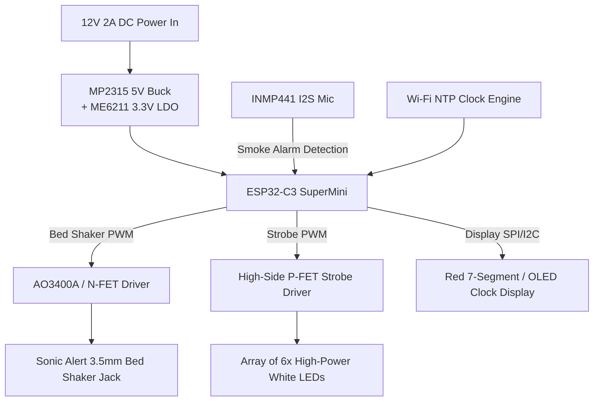
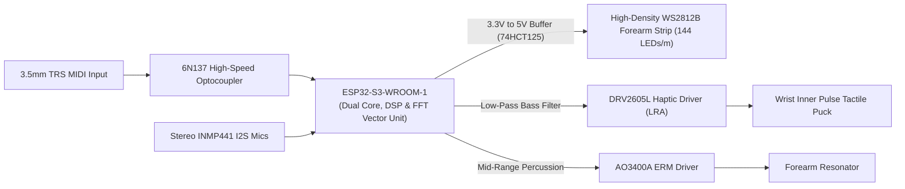
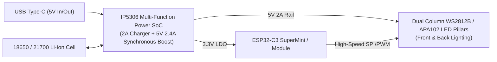

# Parametric PCB Suite: Future Project Ideas & Hardware Roadmap

This document outlines next-generation PCB concepts derived from the active firmware, research prototypes, and experiments in [`public/ESP32Codes/PlatformIO/`](file:///f:/Github/Website/public/ESP32Codes/PlatformIO/).

Each proposal leverages the modular architecture established in the Parametric PCB suite (`shared/footprints.js`, `shared/drc.js`, `shared/export-utils.js`, and real-time DRC validation).

---

## Architecture Matrix & Sourcing Strategy

| # | Project Name | Firmware Origin | Primary ICs / Modules | Form Factor | Assembly Class | Target Unit Cost |
|---|---|---|---|---|---|---|
| **05** | **DeafAlert Mesh Node** | `04_Communications/DeafDoorbell` | ESP32-C3, INMP441, AO3400A (x2) | 45×45mm Wall Puck | Carrier Board | ~$2.80 |
| **06** | **ThermoHaptic Bio-Disc** | `02_Audio_Haptics/CH32V003ThermalHaptics` | CH32V003F4P6, MAX4466, DPAK N-FET | 32×32mm Circular Disc | Turnkey SMT (Economic) | ~$1.45 |
| **07** | **DataGlove Dorsal Hub** | `05_Robotics_Vehicles/DataGlove` | ESP32-C3, 4× Hall, 4× Haptic Drivers | 38×55mm Contoured Dorsal | Carrier Board | ~$3.60 |
| **08** | **AcousticHaptic 40kHz Array** | `09_ultraSonic/UltrasonicHapticDisplay` | RP2040-Zero, TC4427A Drivers, OLED | 60×60mm Hexagonal Matrix | Hybrid (SMT + THT) | ~$5.20 |
| **09** | **NeuralBadge Interactive SAO** | `03_Visuals_Art/CarrieBrainBadge` | ESP32-C3, MPU-6050, SAO Header | 50×42mm Brain Silhouette | Turnkey SMT (Standard) | ~$4.80 |
| **10** | **RadarSense Matter Puck** | `08_Hardware_Specific/HumanDetector` | ESP32-C6-WROOM, HLK-LD2410 mmWave | 36×36mm Mini Box | Turnkey SMT (Economic) | ~$6.50 |
| **11** | **DeafAlert Bedside Strobe Hub** | `06_Clocks/DeafClock` & `PCBClock` | ESP32-C3, 12V Barrel, Strobe Driver | 70×50mm Bedside Hub | Carrier Board | ~$3.90 |
| **12** | **CymaSense Audio-Tactile Brace**| `03_Visuals_Art/CymaSpace` & `MidiLedBrace` | ESP32-S3, Dual INMP441, 74HCT125 | 24×95mm Ergonomic Brace | Turnkey SMT (Economic) | ~$5.80 |
| **13** | **PlasmaRod Reactor Tube** | `03_Visuals_Art/FuelRodsRedesign` | ESP32-C3, Dual LED Pillars, IP5306 | 18×120mm Cylindrical Blade | Double-Sided SMT | ~$4.10 |

---

## 1. Project 05: DeafAlert Mesh Node (Visual Strobe & Tactile Shaker)

### Firmware Origin
- [`public/ESP32Codes/PlatformIO/04_Communications/DeafDoorbell/`](file:///f:/Github/Website/public/ESP32Codes/PlatformIO/04_Communications/DeafDoorbell/)

### Concept & Purpose
A modular, high-reliability visual & tactile alerting node for Deaf and hard-of-hearing households. Communicates over zero-configuration **ESP-NOW broadcast mesh** (<5ms latency):
- **Master Node**: Positioned beside the mechanical or electronic doorbell chime. An onboard INMP441 I2S MEMS microphone samples ambient sound, performs bandpass/threshold filtering in firmware, and broadcasts instantaneous alert packets.
- **Follower Nodes**: Distributed throughout living rooms, bedrooms, and workshops. Drives ultra-bright 5V/12V visual strobe rings and high-current bed-shakers.



### Hardware Specifications
- **Controller**: Socketed ESP32-C3 SuperMini footprint.
- **Audio Front-End (Master Mode)**: INMP441 digital I2S microphone header with isolated analog ground.
- **Strobe Driver (Follower Mode)**: High-side AO3401A P-MOSFET + AO3400A N-MOSFET pre-driver (borrowed from Project 02/03) capable of 5V 3A LED burst power with zero sleep drain.
- **Tactile Shaker Port**: 5.5×2.1mm DC barrel or 3.5mm jack driven by a 30V 5.7A AO3400A N-MOSFET with 1N5819 flyback clamp diode for high-torque bed-shaker solenoids.
- **Power Input**: 5V USB Type-C or screw terminal for 5V–12V DC auxiliary supply with onboard ME6211 3.3V LDO.
- **Form Factor**: 45×45mm square board with M3 mounting holes fitting standard electrical gang boxes and 3D-printed snap cases.

---

## 2. Project 06: ThermoHaptic Bio-Disc (Peltier + Audio-Responsive Haptics)

### Firmware Origin
- [`public/ESP32Codes/PlatformIO/02_Audio_Haptics/CH32V003ThermalHaptics/`](file:///f:/Github/Website/public/ESP32Codes/PlatformIO/02_Audio_Haptics/CH32V003ThermalHaptics/)
- [`public/ESP32Codes/PlatformIO/01_Starters_Tests/CH32V003SanityTest/`](file:///f:/Github/Website/public/ESP32Codes/PlatformIO/01_Starters_Tests/CH32V003SanityTest/)

### Concept & Purpose
An ultra-low-cost, handheld sensory grounding disc for neurodivergent sensory regulation, stress grounding, and game immersion. Explores multimodal sensory feedback combining **active temperature change (Peltier cold/heat)** with **tactile vibration**:
- Sound volume / beats sampled by a MAX4466 directly modulate cooling PWM power to a small 20×20mm or 30×30mm TEC1 Peltier element.
- When ambient noise spikes or music drops, the device creates an instantaneous, tactile chill on the user's palm accompanied by rhythmic vibration.



### Hardware Specifications
- **Microcontroller**: WCH `CH32V003F4P6` (TSSOP-20 package, $0.15 cost). 24MHz RISC-V core with 2KB SRAM, 16KB Flash.
- **Programming Header**: 3-pin 2.54mm connector (VCC, GND, SWIO/PD1) for single-wire flashing via WCH-LinkE.
- **Power Switch**: Heavy-duty surface-mount TO-252 (DPAK) N-Channel MOSFET (`LR7843` or `AO4406A`, LCSC `C8598`) providing low $R_{DS(on)}$ (< 4mΩ) to prevent MOSFET heating under 4A Peltier pulses.
- **Audio Input**: MAX4466 analog microphone module footprint with adjustable gain.
- **Haptic Driver**: SOT-23 AO3400A N-MOSFET with flyback diode for a 3V coin vibration motor.
- **Power Rail**: 5V–12V 2-pin JST-XH input for battery pack or wall adapter.
- **Form Factor**: 32×32mm circular disc with copper heatsink keepout on the bottom layer.

---

## 3. Project 07: DataGlove Dorsal Hub (Multi-Finger Wireless Haptics)

### Firmware Origin
- [`public/ESP32Codes/PlatformIO/05_Robotics_Vehicles/DataGlove/`](file:///f:/Github/Website/public/ESP32Codes/PlatformIO/05_Robotics_Vehicles/DataGlove/)
- [`public/ESP32Codes/PlatformIO/02_Audio_Haptics/WirelessHaptic/`](file:///f:/Github/Website/public/ESP32Codes/PlatformIO/02_Audio_Haptics/WirelessHaptic/)

### Concept & Purpose
A wearable glove controller designed for VR gesture input, teleoperation, and robotics. Mounts comfortably onto the back of the hand (dorsal side):
- Reads 4 to 5 Hall effect sensors or flex resistors along fingers.
- Drives 4 to 5 independent ERM/LRA vibration motors at the fingertips to simulate tactile contact when virtual objects are touched.
- Employs ESP-NOW bidirectional telemetry with < 3ms round-trip latency.



### Hardware Specifications
- **MCU**: ESP32-C3 SuperMini carrier or soldered module.
- **Sensor Connectors**: 4× 3-pin JST-SH (1.0mm pitch) or solder eyelets for Hall effect sensors (GPIO 0, 1, 3, 4).
- **Haptic Drivers**: 4× discrete SOT-23 AO3400A N-MOSFETs with dedicated gate pull-downs and flyback diodes (GPIO 5, 6, 7, 10).
- **Power Management**: Onboard TP4054 LiPo charger (Micro-USB or Type-C) with automatic power-path switching.
- **Mechanical Mounting**: Ergonomic butterfly contour with slots for 20mm elastic Velcro wrist straps.
- **Dimensions**: 38×55mm contoured PCB with rounded chamfer edges.

---

## 4. Project 08: AcousticHaptic 40kHz Array (Mid-Air Ultrasonic Tactile Field)

### Firmware Origin
- [`public/ESP32Codes/PlatformIO/09_ultraSonic/UltrasonicHapticDisplay/`](file:///f:/Github/Website/public/ESP32Codes/PlatformIO/09_ultraSonic/UltrasonicHapticDisplay/)

### Concept & Purpose
A phased or synchronized ultrasonic transducer board that creates **tangible tactile sensations in mid-air** without requiring gloves or contact.
- Emits high-intensity 40.0 kHz acoustic radiation pressure.
- Amplitude-modulated at 50 Hz to 250 Hz (the frequency range where human skin Meissner corpuscles exhibit peak sensitivity).
- Generates localized tactile vibration on fingertips hovering 5cm to 15cm above the board.

```mermaid
flowchart LR
    MCU["Waveshare RP2040-Zero\n(40kHz High-Resolution PWM)"]
    Pots["3x Control Pots\n(Carrier, AM Freq, Duty)"] --> MCU
    OLED["SSD1306 0.96\" I2C OLED"] <-- MCU
    MCU -- "40kHz AM Logic" --> Gate["TC4427A Dual High-Speed Driver"]
    DC12V["12V / 24V DC Input"] --> Gate
    Gate --> Transducers["Array of 40kHz Piezoceramic Transducers\n(16x Transducers in 4x4 Grid)"]
    Transducers --> AcousticFocal["Mid-Air Tactile Focal Point\n(Hovering Hand Feels Vibration)"]
```

### Hardware Specifications
- **Controller**: Waveshare RP2040-Zero footprint (RP2040 PWM hardware slice yields sub-microsecond 40.000 kHz clock synthesis).
- **Driver Stage**: `TC4427A` or `MIC4427` dual high-speed MOSFET driver ICs (1.5A peak sink/source, 20ns rise time) converting 3.3V logic signals into high-current 12V/24V transducer excitation.
- **Transducer Matrix**: 4×4 grid (16 transducers) of standard 16mm 40kHz piezoceramic ultrasonic emitters (Murata `MA40S4S` or LCSC equivalents).
- **User Controls**: Footprints for 3× horizontal rotary potentiometers (tuning Carrier Frequency, AM Rate, and Output Power).
- **Display Header**: 4-pin I2C header for 0.96" SSD1306 OLED telemetry.
- **Form Factor**: 60×60mm hexagonal or square matrix board with high-voltage copper trace clearances.

---

## 5. Project 09: NeuralBadge Interactive Wearable (Artistic SAO Badge)

### Firmware Origin
- [`public/ESP32Codes/PlatformIO/03_Visuals_Art/CarrieBrainBadge/`](file:///f:/Github/Website/public/ESP32Codes/PlatformIO/03_Visuals_Art/CarrieBrainBadge/)
- [`public/ESP32Codes/PlatformIO/03_Visuals_Art/Ember/`](file:///f:/Github/Website/public/ESP32Codes/PlatformIO/03_Visuals_Art/Ember/)

### Concept & Purpose
An artistic, wearable cybernetic badge shaped like an anatomical cerebral cortex:
- Features 9 to 16 addressable RGB LEDs positioned at major cortical lobes.
- Incorporates an onboard MPU-6050 IMU configured with digital high-pass motion interrupt (`DHPF`).
- **Sleep & Wake Dynamics**: When idle, the badge enters deep sleep with LEDs and IMU gyro shut down (< 20µA). When the wearer walks, dances, or taps the badge, the motion interrupt instantly wakes the ESP32 to pulse dynamic color waves and trigger rhythmic haptic "heartbeat" vibrations.
- **SAO Compatibility**: Features a standard 6-pin Shitty Add-On (SAO v1.69bis) connector to daisy-chain auxiliary hacker badge accessories.



### Hardware Specifications
- **MCU**: ESP32-C3-WROOM-02-N4 directly soldered SMT module.
- **IMU**: MPU-6050 QFN-24 onboard sensor (or carrier slot) tied to hardware INT line.
- **LEDs**: 12× ultra-compact `WS2812B-2020` (2.0×2.0mm) LEDs embedded in the top copper layer.
- **Haptics**: SOT-23 AO3400A driver connected to a 1027 coin vibration motor glued into a backside pocket.
- **Expansion**: Standard SAO 2×3 pin header (VCC, GND, SDA, SCL, GPIO1, GPIO2).
- **Silkscreen Art**: High-contrast matte black solder mask with exposed ENIG gold immersion brain convolutions and Seigaiha wave accents.
- **Form Factor**: 50×42mm contoured badge with dual lanyard attachment eyelets and safety pin clip footprint.

---

## 6. Project 10: RadarSense Matter Puck (24GHz mmWave Human Presence)

### Firmware Origin
- [`public/ESP32Codes/PlatformIO/08_Hardware_Specific/HumanDetector/`](file:///f:/Github/Website/public/ESP32Codes/PlatformIO/08_Hardware_Specific/HumanDetector/)
- [`public/ESP32Codes/PlatformIO/08_Hardware_Specific/ESP32C6/`](file:///f:/Github/Website/public/ESP32Codes/PlatformIO/08_Hardware_Specific/ESP32C6/)

### Concept & Purpose
A modern smart-home occupancy detector powered by **ESP32-C6 (Matter / Thread / Zigbee 3.0 / Wi-Fi 6)**:
- Solves the fundamental flaw of traditional PIR motion sensors (which fail when a person sits still, reads, or sleeps).
- Directly mates with the **HLK-LD2410 24GHz FMCW mmWave radar sensor**, capable of detecting micro-motion (breathing, chest movement) up to 6 meters away.
- Exposes native Matter-over-Thread and Home Assistant integration for smart lighting and HVAC automation.

```mermaid
flowchart LR
    Radar["HLK-LD2410 mmWave Radar\n(UART 256000 baud)"] -- "Micro-Motion & Range" --> C6["ESP32-C6 Microcontroller\n(Matter / Thread / Wi-Fi 6)"]
    Env["SHTC3 Sensor"] -- "Temp & Humidity (I2C)" --> C6
    OLED["0.96\" I2C OLED (Optional)"] <-- C6
    C6 -- "Matter over Thread" --> Home["Home Assistant / Apple Home / Google Home"]
```

### Hardware Specifications
- **MCU**: `ESP32-C6-WROOM-1-N8` (RISC-V 32-bit @ 160MHz with native 802.15.4 Thread radio).
- **Radar Socket**: 5-pin 1.27mm / 2.54mm socket designed specifically for the `HLK-LD2410B` / `LD2410C` mmWave module.
- **Environmental Sensor**: Onboard `SHTC3` or `AHT20` I2C temperature and humidity sensor.
- **Power Supply**: 5V USB Type-C with high-efficiency buck regulator (`SY8089` 3.3V 2A) to supply high transient currents demanded by 24GHz radar chirp bursts.
- **Form Factor**: 36×36mm compact puck designed to snap into standard 3D printed wall/ceiling mounts.

---

## 7. Project 11: DeafAlert Bedside Strobe Hub (High-Power Alarm Hub)

### Firmware Origin
- [`public/ESP32Codes/PlatformIO/06_Clocks/DeafClock/`](file:///f:/Github/Website/public/ESP32Codes/PlatformIO/06_Clocks/DeafClock/)
- [`public/ESP32Codes/PlatformIO/06_Clocks/PCBClock/`](file:///f:/Github/Website/public/ESP32Codes/PlatformIO/06_Clocks/PCBClock/)

### Concept & Purpose
An emergency bedside alarm clock and alert hub designed specifically for deaf individuals who cannot hear standard audible smoke alarms or wake-up sirens:
- Synchronizes time via Wi-Fi NTP.
- Listens continuously via an onboard INMP441 microphone for T3/T4 commercial smoke/CO alarm sound patterns (3100 Hz 3-pulse cadence).
- When triggered, it fires a **12V high-power bed shaker** under the mattress and flashes an array of high-intensity white strobe LEDs to awaken the sleeper instantly.



### Hardware Specifications
- **Input Power**: 12V DC barrel jack (supplies both the bed shaker and the LED strobe).
- **Bed Shaker Output**: Standard 3.5mm mono audio jack or screw terminal wired to an AO3400A N-MOSFET (supports commercial 12V bed-shakers like Sonic Alert `SS12VW`).
- **Visual Strobe**: 6× high-flux 5730 SMD white LEDs (150mA each) driven in pulsed strobe mode.
- **Audio Detection**: INMP441 I2S microphone positioned along the perimeter.
- **Clock Display**: Footprint for 4-digit 0.56" 7-segment LED display with TM1637 driver or 128×64 SSD1306 OLED.
- **Dimensions**: 70×50mm rectangular desktop housing.

---

## 8. Project 12: CymaSense Audio-Tactile Brace (Stage Wearable)

### Firmware Origin
- [`public/ESP32Codes/PlatformIO/03_Visuals_Art/CymaSpace/`](file:///f:/Github/Website/public/ESP32Codes/PlatformIO/03_Visuals_Art/CymaSpace/)
- [`public/ESP32Codes/PlatformIO/03_Visuals_Art/MidiLedBrace/`](file:///f:/Github/Website/public/ESP32Codes/PlatformIO/03_Visuals_Art/MidiLedBrace/)
- [`public/ESP32Codes/PlatformIO/03_Visuals_Art/LightBaton/`](file:///f:/Github/Website/public/ESP32Codes/PlatformIO/03_Visuals_Art/LightBaton/)

### Concept & Purpose
A concert and stage-performance arm brace developed in the spirit of CymaSpace's mission (translating sound into light and tactile vibration for inclusive performance arts):
- Features stereo microphone inputs for spatial audio analysis.
- Drives high-density NeoPixel strips running along the forearm.
- Features dual high-output eccentric rotating mass (ERM) or linear resonant actuator (LRA) haptic drivers placed firmly against the wrist pulse points to allow the wearer to physically feel bass lines, percussion, and musical rhythm.
- Supports 3.5mm TRS MIDI Type-A/B input to sync directly with synthesizers and stage lighting consoles.



### Hardware Specifications
- **MCU**: `ESP32-S3-WROOM-1` (Dual-core Xtensa LX7 with vector instructions for real-time 512-point FFT frequency binning).
- **Haptic Controllers**: Onboard `DRV2605L` I2C haptic motor driver supporting ERM and LRA actuators with 123 built-in haptic effects library.
- **Level Shifter**: `74HCT125D` quad buffer to cleanly shift 3.3V GPIO to 5.0V CMOS logic levels for flawless NeoPixel transmission.
- **MIDI Port**: 3.5mm TRS MIDI jack with optoisolated 6N137 receiver.
- **Form Factor**: 24×95mm elongated forearm brace with rounded ends and strap cutouts.

---

## 9. Project 13: PlasmaRod Reactor Tube (Interactive Cosplay Core)

### Firmware Origin
- [`public/ESP32Codes/PlatformIO/03_Visuals_Art/FuelRodsRedesign/`](file:///f:/Github/Website/public/ESP32Codes/PlatformIO/03_Visuals_Art/FuelRodsRedesign/)
- [`public/ESP32Codes/PlatformIO/01_Starters_Tests/xYmotorLedStrip/`](file:///f:/Github/Website/public/ESP32Codes/PlatformIO/01_Starters_Tests/xYmotorLedStrip/)

### Concept & Purpose
A double-sided, tubular sci-fi "plasma fuel cell" designed to slide inside translucent acrylic or polycarbonate tubes for props, gaming rigs, and installations:
- Houses two parallel columns of high-density addressable LEDs running up the left and right sides.
- Mimics bubbling plasma, energy discharge surges, and reactor core meltdowns using FastLED noise functions.
- Integrated Li-ion cell power management: charges via USB-C and features direct spring terminal pads for an 18650 or 21700 lithium battery cell.



### Hardware Specifications
- **Power Architecture**: `IP5306` fully integrated power-bank SoC (handles Li-ion constant-current/constant-voltage charging, battery capacity level LEDs, and synchronous 5V boost to deliver up to 2.4A for LED bursts).
- **LED Channels**: Dual back-to-back columns of 16× WS2812B-3535 or APA102-2020 LEDs.
- **Battery Contacts**: Plated heavy copper pads for Keystone 209/210 18650 leaf-spring contacts soldered directly to the PCB.
- **Form Factor**: 18×120mm narrow blade designed to slide into standard 1-inch (25.4mm) OD polycarbonate saber tubes.

---

## 10. Recommended Implementation Priority

When ready to expand the Parametric PCB suite, implement in the following order based on utility and ease of manufacturing:

1. **Project 05 (DeafAlert Mesh Node)**: Direct drop-in reuse of Project 02/03 carrier circuitry. Solves a major accessibility need and pairs seamlessly with existing `04_Communications/DeafDoorbell` firmware.
2. **Project 06 (ThermoHaptic Bio-Disc)**: Introduces the sub-$0.20 CH32V003 RISC-V footprint into the tscircuit library, creating a foundation for disposable, sub-$1.50 smart devices.
3. **Project 09 (NeuralBadge Interactive Wearable)**: High visual impact for portfolio presentation, featuring ENIG art silkscreen, motion-to-light interactivity, and standard SAO expandability.
4. **Project 08 (AcousticHaptic 40kHz Array)**: Advanced hardware showcase featuring high-frequency power electronics and mid-air tactile physics.
