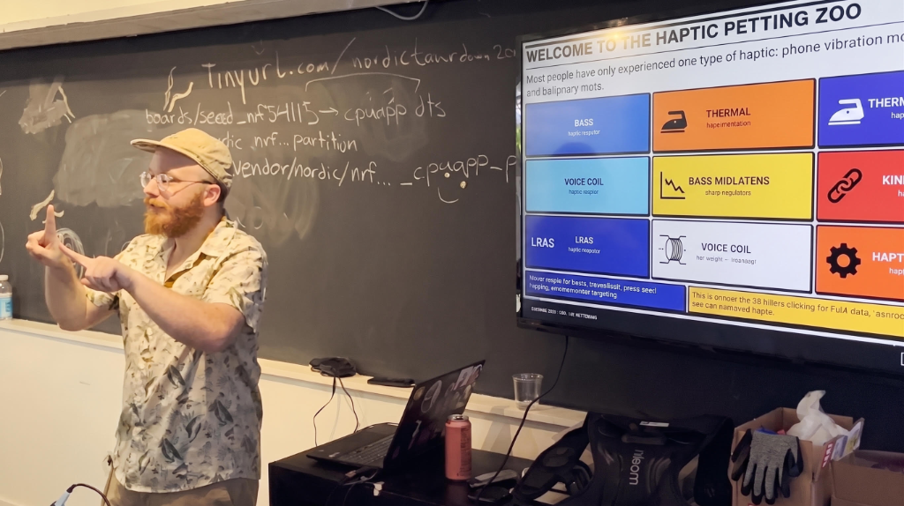
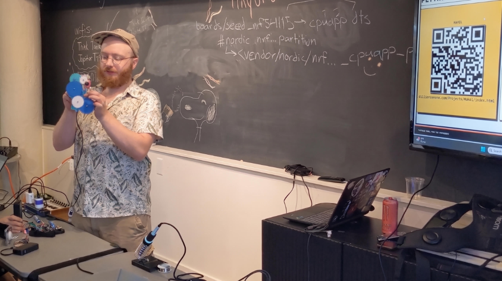
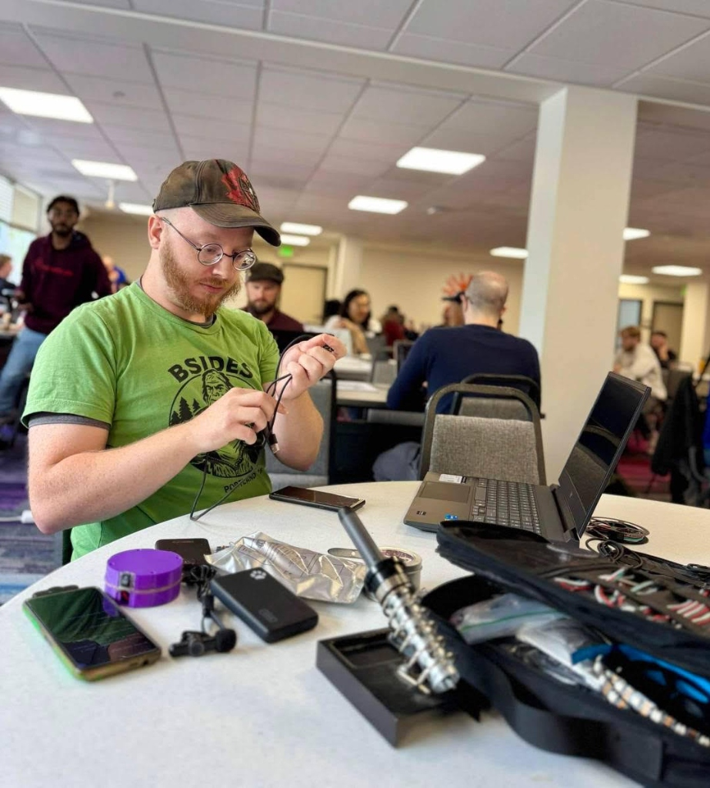
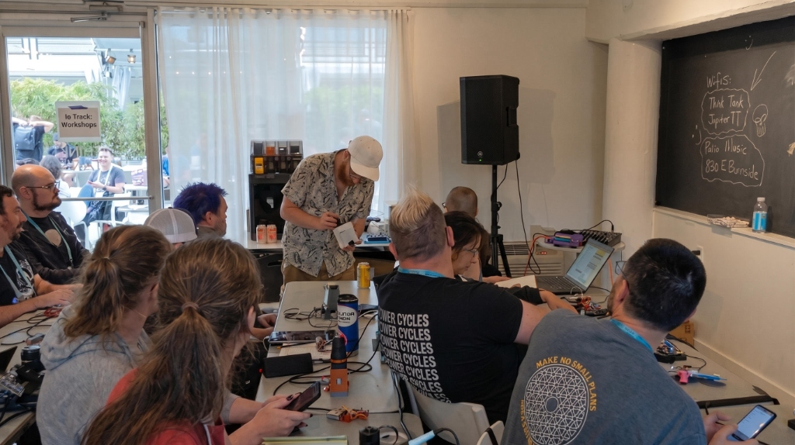

# The Haptic Petting Zoo (2026–2028)

**The Haptic Petting Zoo** is a touring, multi-sensory interactive exhibition designed to make sound tangible and accessible through the sense of touch. Fiscally sponsored by **Control+H (PDX Hackerspace)** and funded by the **Oregon Community Foundation Creative Heights Grant ($96,000)** and matching education initiatives.

---

## 📸 Press & High-Resolution Media Kit

All high-resolution photography, workshop imagery, schematics, and press assets are located in the [`images/`](./images/) directory:

👉 **[Browse Full Press & Media Asset Kit](./images/README.md)**

### Highlights

| Presentation & Live ASL | Mechanical Gear Actuator Demo |
| :---: | :---: |
|  |  |
| *Multi-modal haptic taxonomy talk at Teardown 2026* | *3D-printed active detent & kinesthetic mechanism* |

| Hardware Assembly & Workbench | Interactive Workshop Audience |
| :---: | :---: |
|  |  |
| *ESP32-C6 haptic drivers & fixture prototyping* | *Hands-on community workshop in Portland* |

---

## 🎛️ Architecture & Key Components

1. **Pelican Air Rugged Modular Touring Stations**: Self-contained, accessible touch fixtures engineered for high durability across Oregon libraries, schools, and maker hubs.
2. **HAXEL Tactile Synthesis Framework**: ESP32-C6 firmware providing real-time audio-to-tactile transduction across 7 distinct sensory modalities (voice coils, LRAs, solenoids, Peltier thermal, acoustic wind, smart detent knobs, and bass bone conduction).
3. **STEM Mini-Zoo Educational Kits**: Desktop breakout hardware for maker education and classroom curriculum.

---

## 🤖 Antigravity AI Subagents Quick Reference

You can spawn specialized AI subagents in this workspace at any time to assist with specific project streams:

* **`zoo-press` (News Releases & Communications)**:
  * Drafts *The Portland Tactile Dispatch* articles in `index.html`.
  * Writes press releases, venue host booking packages, and festival outreach proposals (e.g., Corvallis Kaleidoscope / PRAx).
  * Enforces adblock immunity (never uses `ad` classes/IDs).
  * *Example Prompt:* `Spawn zoo-press to draft our next Dispatch edition covering the Dec 12 CymaSpace reveal.`

* **`zoo-planning` (Grant Administrator & Tax Strategist)**:
  * Maintains `ledger/ledger-data.json` and updates `ledger/ledger.html`.
  * Tracks Exhibit B direct costs cap ($91,200), logs billable hours via milestone progress (no public $/hr rates).
  * Manages cash-basis sole proprietorship tax pacing and 11/11 bulk hardware orders.
  * *Example Prompt:* `Spawn zoo-planning to review my 2026 year-end tax pacing and log 5 hours for today's R&D.`

* **`zoo-prototype` (Hardware & Systems Engineer)**:
  * Develops ESP32-S3 lid camera spatial computer vision (3 proximity zones).
  * Integrates VL53L1X ToF failover sensors and 5V coin vibration MOSFET PWM drivers.
  * Manages component verification for the Dec 12 CymaSpace prototype reveal and WDT STEM kits.
  * *Example Prompt:* `Spawn zoo-prototype to write the overhead hand-tracking script and test pinouts.`

---

## 🔗 Links & Resources

* 🌐 **Live Web Gazette & Tour Guide**: [dillonsimeone.com/Projects/HapticPettingZoo/index.html](https://dillonsimeone.com/Projects/HapticPettingZoo/index.html)
* 🌐 **HAXEL Web IDE**: [dillonsimeone.com/Projects/Haxel/index.html](https://dillonsimeone.com/Projects/Haxel/index.html)
* 💻 **Open Source Firmware Tree**: [`public/ESP32Codes/PlatformIO/02_Audio_Haptics/Haxel`](../../ESP32Codes/PlatformIO/02_Audio_Haptics/Haxel/)
* 🎥 **Teardown 2026 Talk**: [Watch on YouTube](https://youtu.be/QELd3fTHwCc)
